# 架构与副本

## 架构说明
Apache Kafka是一个分布式事件处理平台，用于生成、消费、处理和管理事件。

```mermaid
%% Generated by https://gitdiagram.com/apache/kafka
flowchart TD

subgraph group_clients["Client APIs"]
  node_producer["Producer"]
  node_consumer["Consumer"]
  node_admin["Admin API"]
  node_clientnet["Client networking<br/>[NetworkClient.java]"]
end

subgraph group_broker["Broker Runtime"]
  node_broker["Kafka broker"]
  node_replication["Replication"]
  node_groupsvc["Group coordination"]
  node_groupstate[("Group metadata")]
  node_sharesvc["Share coordination"]
  node_transaction["Transactions"]
  node_remoteapi["Remote storage API"]
  node_remoteimpl["Remote storage adapter"]
  node_remote_metadata["Segment metadata"]
  node_metadata_store[("Remote metadata store")]
end

subgraph group_streaming["Streaming Extensions"]
  node_connect["Kafka Connect"]
  node_transforms["Record transforms"]
  node_streams["Kafka Streams"]
  node_mirror["MirrorMaker client<br/>[MirrorClient.java]"]
end

subgraph group_operations["Operations"]
  node_storagecli["Storage tool<br/>[StorageTool.scala]"]
end

subgraph group_shared["Shared Infrastructure"]
  node_metrics["Metrics<br/>[Metrics.java]"]
  node_ssl["TLS configuration"]
  node_uuid["UUID utilities<br/>[Uuid.java]"]
  node_time["Time utilities<br/>[Time.java]"]
  node_topic["Topic utilities<br/>[Topic.java]"]
  node_errors["Protocol errors<br/>[Errors.java]"]
end

node_user(("Application user"))

node_user -->|"publishes events"| node_producer
node_user -->|"reads events"| node_consumer
node_user -->|"administers cluster"| node_admin
node_producer -.->|"sends requests"| node_clientnet
node_consumer -.->|"sends requests"| node_clientnet
node_admin -.->|"sends requests"| node_clientnet
node_clientnet -.->|"network protocol"| node_broker
node_broker -.->|"hosts"| node_replication
node_broker -.->|"coordinates groups"| node_groupsvc
node_groupsvc -.->|"manages metadata"| node_groupstate
node_broker -.->|"coordinates shares"| node_sharesvc
node_broker -.->|"coordinates transactions"| node_transaction
node_broker -.->|"uses adapter"| node_remoteimpl
node_remoteimpl -->|"delegates storage"| node_remoteapi
node_remoteapi -->|"accepts segment metadata"| node_remote_metadata
node_remoteapi -->|"metadata coordinated separately"| node_metadata_store
node_user -->|"integrates data"| node_connect
node_connect -.->|"applies transforms"| node_transforms
node_user -->|"builds stream apps"| node_streams
node_user -.->|"mirrors clusters"| node_mirror
node_user -->|"formats storage"| node_storagecli
node_storagecli -.->|"formats metadata"| node_metadata_store
node_sharesvc -->|"uses time"| node_time
node_groupsvc -->|"uses topic constants"| node_topic
node_sharesvc -->|"uses topic constants"| node_topic
node_groupsvc -->|"maps protocol errors"| node_errors
node_sharesvc -->|"maps protocol errors"| node_errors
node_remoteimpl -->|"handles segment metadata"| node_remote_metadata
node_user -.->|"configures secure clients"| node_ssl

click node_producer "https://github.com/apache/kafka/tree/trunk/clients/src/main/java/org/apache/kafka/clients/producer"
click node_consumer "https://github.com/apache/kafka/tree/trunk/clients/src/main/java/org/apache/kafka/clients/consumer"
click node_admin "https://github.com/apache/kafka/tree/trunk/clients/src/main/java/org/apache/kafka/clients/admin"
click node_clientnet "https://github.com/apache/kafka/blob/trunk/clients/src/main/java/org/apache/kafka/clients/NetworkClient.java"
click node_broker "https://github.com/apache/kafka/tree/trunk/core/src/main/scala/kafka/server"
click node_replication "https://github.com/apache/kafka/blob/trunk/core/src/main/scala/kafka/server/ReplicaManager.scala"
click node_groupsvc "https://github.com/apache/kafka/blob/trunk/group-coordinator/src/main/java/org/apache/kafka/coordinator/group/GroupCoordinatorService.java"
click node_groupstate "https://github.com/apache/kafka/blob/trunk/group-coordinator/src/main/java/org/apache/kafka/coordinator/group/GroupMetadataManager.java"
click node_sharesvc "https://github.com/apache/kafka/blob/trunk/share-coordinator/src/main/java/org/apache/kafka/coordinator/share/ShareCoordinatorService.java"
click node_transaction "https://github.com/apache/kafka/tree/trunk/transaction-coordinator/src/main/java/org/apache/kafka/coordinator/transaction"
click node_remoteapi "https://github.com/apache/kafka/blob/trunk/storage/api/src/main/java/org/apache/kafka/server/log/remote/storage/RemoteStorageManager.java"
click node_remoteimpl "https://github.com/apache/kafka/blob/trunk/storage/src/main/java/org/apache/kafka/server/log/remote/storage/ClassLoaderAwareRemoteStorageManager.java"
click node_connect "https://github.com/apache/kafka/tree/trunk/connect/runtime/src/main/java/org/apache/kafka/connect/runtime"
click node_transforms "https://github.com/apache/kafka/blob/trunk/connect/transforms/src/main/java/org/apache/kafka/connect/transforms/TimestampRouter.java"
click node_streams "https://github.com/apache/kafka/tree/trunk/streams/src/main/java/org/apache/kafka/streams"
click node_mirror "https://github.com/apache/kafka/blob/trunk/connect/mirror-client/src/main/java/org/apache/kafka/connect/mirror/MirrorClient.java"
click node_storagecli "https://github.com/apache/kafka/blob/trunk/core/src/main/scala/kafka/tools/StorageTool.scala"
click node_metrics "https://github.com/apache/kafka/blob/trunk/clients/src/main/java/org/apache/kafka/common/metrics/Metrics.java"
click node_ssl "https://github.com/apache/kafka/blob/trunk/clients/src/main/java/org/apache/kafka/common/security/ssl/DefaultSslEngineFactory.java"
click node_uuid "https://github.com/apache/kafka/blob/trunk/clients/src/main/java/org/apache/kafka/common/Uuid.java"
click node_time "https://github.com/apache/kafka/blob/trunk/clients/src/main/java/org/apache/kafka/common/utils/Time.java"
click node_topic "https://github.com/apache/kafka/blob/trunk/clients/src/main/java/org/apache/kafka/common/internals/Topic.java"
click node_errors "https://github.com/apache/kafka/blob/trunk/clients/src/main/java/org/apache/kafka/common/protocol/Errors.java"
click node_remote_metadata "https://github.com/apache/kafka/blob/trunk/storage/api/src/main/java/org/apache/kafka/server/log/remote/storage/RemoteLogSegmentMetadata.java"
click node_metadata_store "https://github.com/apache/kafka/tree/trunk/storage/api/src/main/java/org/apache/kafka/server/log/remote/storage"

classDef toneNeutral fill:#f8fafc,stroke:#334155,stroke-width:1.5px,color:#0f172a
classDef toneBlue fill:#dbeafe,stroke:#2563eb,stroke-width:1.5px,color:#172554
classDef toneAmber fill:#fef3c7,stroke:#d97706,stroke-width:1.5px,color:#78350f
classDef toneMint fill:#dcfce7,stroke:#16a34a,stroke-width:1.5px,color:#14532d
classDef toneRose fill:#ffe4e6,stroke:#e11d48,stroke-width:1.5px,color:#881337
classDef toneIndigo fill:#e0e7ff,stroke:#4f46e5,stroke-width:1.5px,color:#312e81
classDef toneTeal fill:#ccfbf1,stroke:#0f766e,stroke-width:1.5px,color:#134e4a
class node_producer,node_consumer,node_admin,node_clientnet,node_user toneBlue
class node_broker,node_replication,node_groupsvc,node_groupstate,node_sharesvc,node_transaction,node_remoteapi,node_remoteimpl,node_remote_metadata,node_metadata_store toneAmber
class node_connect,node_transforms,node_streams,node_mirror toneMint
class node_storagecli toneRose
class node_metrics,node_ssl,node_uuid,node_time,node_topic,node_errors toneIndigo
```

[架构图](https://gitdiagram.com/apache/kafka)

## 交互演示

点击下面的按钮，观察事件如何依次经过 **Producer → Topic/Partition → Consumer → Processing/Management**：

<div id="kafka-demo"></div>

## 延伸阅读

下面按演示动作整理外部资源，每条都标注「怎么用」和「能了解什么」，链接会在新标签页打开。先建立直觉用 **Kafka Playground / Aiven**；看故障与耐久性用 **Kafka Flow / Kafka Simulator / Kafka Is Fun**；核准术语与配置回看 **官方文档**。

??? tip "总览：先建立心智模型"
    - **怎么用**：通读 [Kafka Intro](https://kafka.apache.org/intro/){: target="_blank" rel="noopener"} 的 *Main Concepts and Terminology*，再看 [Aiven Visualization](https://aiven.io/tools/kafka-visualization){: target="_blank" rel="noopener"}，调整 partitions / brokers / replication factor 和动画速度，观察消息从 producer 到 leader、再复制到 follower 的过程。
    - **能了解**：event 的 key/value/timestamp、topic 是多生产者多订阅的持久日志、partition 是有序日志、同 key 保序、副本带来容错；Aiven 中半透明消息代表 follower 副本。
    - **配套文档**：[Kafka APIs](https://kafka.apache.org/43/apis/){: target="_blank" rel="noopener"} 总览六大 API，正好对应演示里的生成、消费、处理、管理四个入口。

??? note "生成事件：Producer 与分区"
    - **怎么用**：打开 [Kafka Playground](https://dev48v.github.io/kafka-playground/){: target="_blank" rel="noopener"}，输入 key/value 点 `Produce`；把 partitions 从 3 调到 5，分别用「相同 key」和「无 key」各发几条，观察 partition 列和 `hashes to a partition` 提示。
    - **能了解**：key 哈希决定分区；同 key 必进同一分区且分区内有序；无 key 时轮询分散；producer 通过 metadata 找到 partition leader 并直接写入，无需中间路由层。
    - **配套文档**：[Producer API](https://kafka.apache.org/43/apis/){: target="_blank" rel="noopener"}、[Design / The Producer](https://kafka.apache.org/26/design/design/){: target="_blank" rel="noopener"}、[Protocol / Partitioning and bootstrapping](https://kafka.apache.org/41/design/protocol/){: target="_blank" rel="noopener"}。

??? note "消费事件：Consumer Group 与 Offset"
    - **怎么用**：在 [Kafka Playground](https://dev48v.github.io/kafka-playground/){: target="_blank" rel="noopener"} 里把 consumer group `app` 的人数从 2 加到 3 再加到 4，点 `Consume one round`，观察分区归属和 `pending (lag)` / `consumed (committed)` 的变化。
    - **能了解**：一个分区在同一 group 内只归一个 consumer；3 分区最多 3 个活跃 consumer，第 4 个空闲；consumer 自己维护 offset，可回退重放；commit 推进后 lag 下降；rebalance 发生在成员或分区变化时。
    - **配套文档**：[Confluent / Consumer Design](https://docs.confluent.io/kafka/design/overview.html){: target="_blank" rel="noopener"}、[Design / Consumer Position](https://kafka.apache.org/26/design/design/){: target="_blank" rel="noopener"}、[Consumer API](https://kafka.apache.org/43/apis/){: target="_blank" rel="noopener"}。

??? note "处理事件：Streams 与交付语义"
    - **怎么用**：对照 [Kafka APIs / Streams API](https://kafka.apache.org/43/apis/){: target="_blank" rel="noopener"} 看一次转换；再到 [Kafka Simulator](https://monedula.dev/kafka-simulator/){: target="_blank" rel="noopener"} 打开 *Idempotence retry* 场景，比较开/关幂等时重复消息是否消失，并用 *Transactions & EOS* 场景看 LSO 与 zombie fencing。
    - **能了解**：Streams 从输入 topic 读、转换后写回输出 topic；at-most-once / at-least-once / exactly-once 的边界；producer 幂等用 PID + sequence 去重；事务实现跨分区原子写和 EOS。
    - **配套文档**：[Design / Message Delivery Semantics](https://kafka.apache.org/26/design/design/){: target="_blank" rel="noopener"}、[Javadoc Overview](https://kafka.apache.org/43/javadoc/){: target="_blank" rel="noopener"}。

??? note "管理事件：Admin、ISR 与故障"
    - **怎么用**：在 [Kafka Flow](https://kafka-flow.com/){: target="_blank" rel="noopener"} 切换 `acks=0 / 1 / all` 发请求，暂停 follower fetch 看 ISR 与 HW 变化，再用 step backward/forward 回放；然后到 [Kafka Is Fun](https://kafkaisfun.dev/simulate){: target="_blank" rel="noopener"} 停 broker、拖 lag 滑块、在 ISR 降级时发 `acks=all`，读时间线解释。
    - **能了解**：leader append → follower fetch → HW 推进 → consumer 可见；`acks=all` 配合 `min.insync.replicas` 才会拒绝写入而不是丢数据；ISR 收缩、leader election、unclean leader 风险；Admin API 管理 topic / ACL / broker 配置。
    - **想系统化演练**：[Kafka Simulator](https://monedula.dev/kafka-simulator/){: target="_blank" rel="noopener"} 有 169 个可重放场景（Canonical failure、acks trade-off、min.ISR boundary、Slow follower 等），模型基线 Kafka 4.4；[Admin API](https://kafka.apache.org/43/apis/){: target="_blank" rel="noopener"} 与 [KafkaAdminClient Javadoc](https://kafka.apache.org/43/javadoc/){: target="_blank" rel="noopener"} 查具体方法。

## 基本组成

- **Producer / Consumer**：生产与消费客户端
- **Broker**：消息存储与转发节点
- **Controller**：负责分区 Leader 选举与集群元数据管理
- **Topic → Partition → Segment**：主题拆分为有序分区，分区再按段落盘


## 副本机制


| 角色 | 职责 |
| --- | --- |
| Leader | 处理读写请求 |
| Follower | 从 Leader 同步数据 |
| ISR | 与 Leader 保持同步的副本集合 |

- `HW`（High Watermark）：消费者可见的最大位移
- `LEO`（Log End Offset）：每个副本最后一条消息的位移
- 只有 ISR 中的副本才有资格被选为 Leader

## 读写流程

```text
Producer → 按 key/轮询选择分区 → 追加到 Leader 日志
Consumer → 按分区顺序拉取 → 维护自身 offset
```

## 待补充

- ISR 收缩与 `replica.lag.time.max.ms`
- Controller 故障转移
- 分区再均衡（Rebalance）策略
